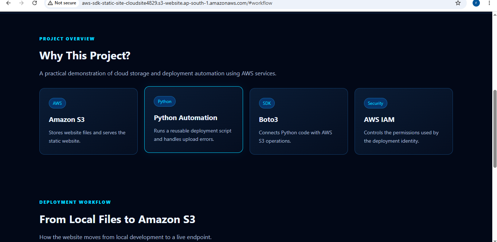
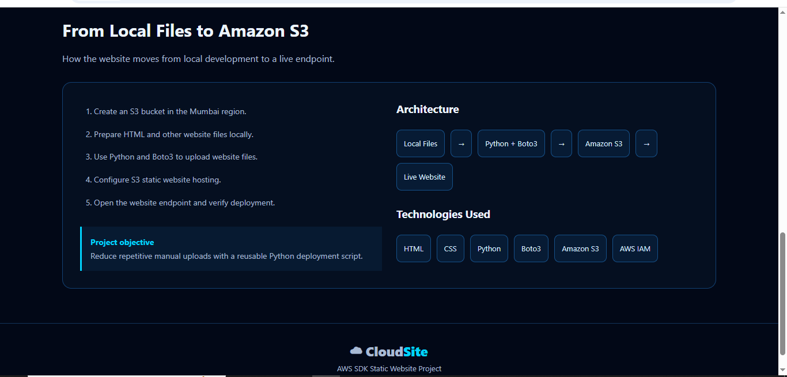
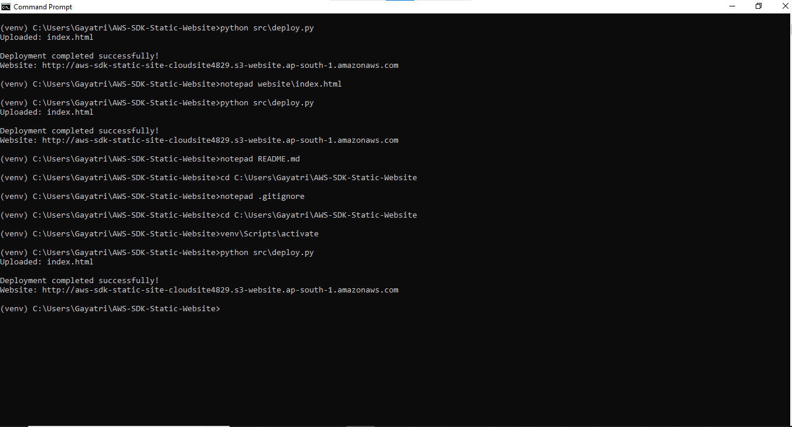
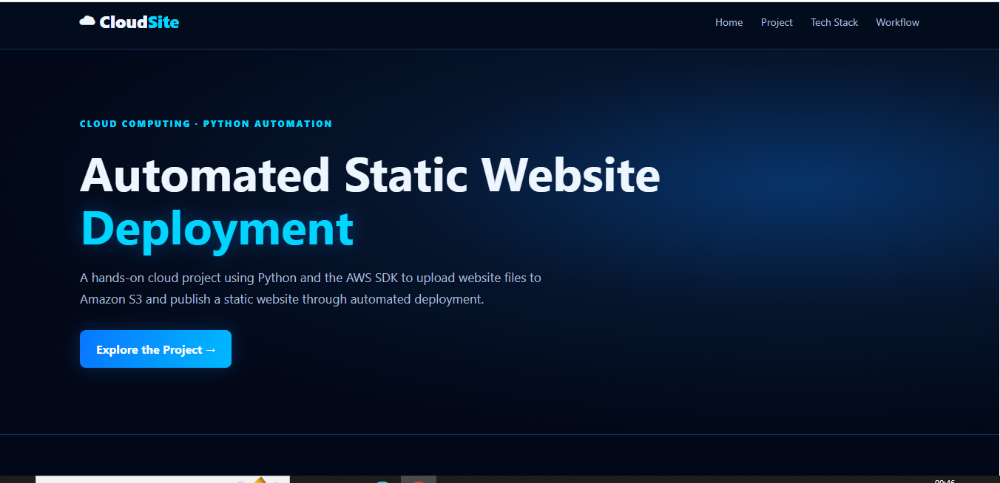

# AWS Static Website Hosting Using Python and Boto3

## 1. Project Objective

The objective of this project is to automate static website deployment on Amazon S3 using Python and the AWS SDK for Python (Boto3).

The project uploads website files from a local folder to an Amazon S3 bucket and makes the website accessible through the S3 static website hosting endpoint.

## 2. AWS Services and Technologies Used

* Amazon S3
* AWS IAM
* Python
* Boto3
* HTML
* CSS
* AWS CLI

## 3. Architecture and Workflow

```text
Local Website Files
       |
       v
Python Deployment Script
       |
       v
AWS SDK for Python (Boto3)
       |
       v
Amazon S3 Bucket
       |
       v
Static Website Hosting
       |
       v
Web Browser
```

## 4. Project Structure

```text
AWS-SDK-Static-Website/
|
|-- src/
|   |-- deploy.py
|
|-- website/
|   |-- index.html
|
|-- README.md
|-- .gitignore
```

## 5. Implementation Steps

1. Created a local project folder and Python virtual environment.
2. Developed a static website using HTML and CSS.
3. Created an Amazon S3 bucket in the Asia Pacific (Mumbai) region.
4. Configured AWS credentials locally using an AWS CLI profile.
5. Enabled static website hosting on the S3 bucket.
6. Configured the necessary S3 permissions for public website access.
7. Developed a Python deployment script using Boto3.
8. Uploaded the website files to Amazon S3 using the deployment script.
9. Tested the website using the S3 website endpoint.

## 6. How to Run the Project

### Prerequisites

* Python installed on your computer
* An AWS account
* AWS CLI installed and configured
* Boto3 installed in the Python environment
* An S3 bucket configured for static website hosting
* Appropriate IAM permissions

### Step 1: Activate the virtual environment

On Windows:

```cmd
venv\Scripts\activate
```

### Step 2: Install Boto3

```cmd
python -m pip install boto3
```

### Step 3: Configure AWS credentials

Configure an AWS CLI profile named `static-website` using your own AWS credentials.

Do not add AWS access keys or secret keys to this repository.

### Step 4: Configure the deployment script

Ensure `src/deploy.py` uses the correct AWS profile, bucket name, and region for your environment.

### Step 5: Deploy the website

Run this command from the project root:

```cmd
python src/deploy.py
```

The script uploads the website files to the configured S3 bucket.

### Step 6: Open the website

Open the S3 static website endpoint printed by the deployment script in your browser.

## ## 7. Screenshots

### S3 Bucket



### Static Website Hosting Configuration



### Successful Python Deployment



### Live Website



## 8. Security Considerations

* Use IAM permissions limited to the actions required by the project.
* Never upload AWS credentials, secret keys, or local credential files to GitHub.
* Do not upload the Python virtual environment.
* Public website access should be restricted to the intended website content.
* Review AWS pricing before enabling additional services.
* The S3 website endpoint uses HTTP. HTTPS can be configured using an appropriate service such as Amazon CloudFront, with possible additional charges.

## 9. Key Learnings

* Learned how to host a static website using Amazon S3.
* Learned how to automate AWS tasks using Python and Boto3.
* Practiced AWS CLI profile configuration.
* Learned about IAM permissions and S3 bucket policies.
* Understood how to deploy local website files to AWS.
* Practiced troubleshooting website access and deployment errors.

## 10. Project Outcome

Successfully deployed a static website to Amazon S3 using a Python and Boto3 deployment script. The project demonstrates basic AWS automation, cloud storage configuration, IAM permissions, and static website hosting.

## 11. Future Improvements

* Add automated deployment through GitHub Actions.
* Configure HTTPS using Amazon CloudFront.
* Add deployment logs and error handling.
* Improve access control and security monitoring.

## 12. Author

Developed as a hands-on AWS and Python learning project.
